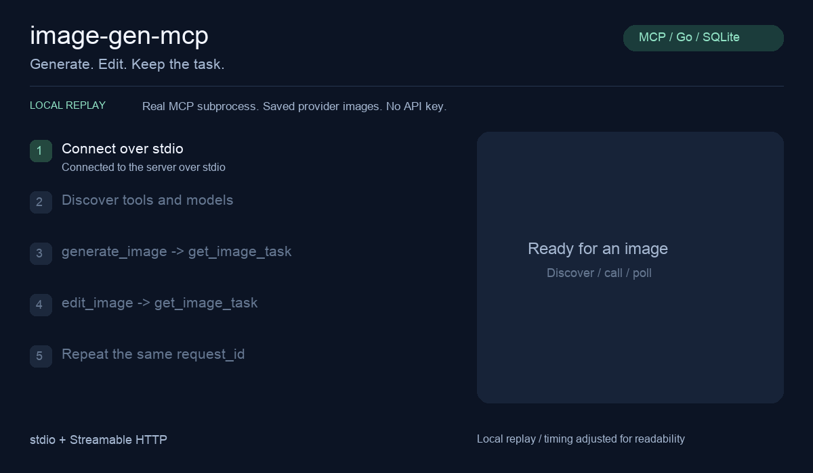

# image-gen-mcp

**让 MCP 客户端生成和编辑图片。单个 Go 程序，多服务商接入，任务持久保存。**

[English](README.md) · [零密钥演示](docs/demo.md) · [下载](https://github.com/zouxiaoliang/image-gen-mcp/releases) · [完整使用手册](docs/guide.zh-CN.md)

[](https://github.com/zouxiaoliang/image-gen-mcp/actions/workflows/ci.yml)



*真实 MCP 子进程 + 本地模拟上游，回放已验证的 BitAPI 图片，不调用真实模型、不需要密钥。[复现步骤与图片来源](docs/demo.md)。*

## 能做什么

- **在 Agent 工作流中生成与编辑图片**：文字生图、参考图编辑、可选 PNG 蒙版。
- **多服务商、多模型别名**：OpenAI Images、OpenAI 兼容网关、Gemini 原生接口。
- **同时拿到预览和原图**：支持图片内容的客户端显示预览；stdio 返回原图路径，HTTP 返回下载 URL。
- **长任务可查询和恢复**：SQLite 持久化、后台队列、轮询、取消和可选过期清理。
- **相同请求不重复提交**：相同 `request_id` 与参数返回已有任务；结果不确定时标记 `unknown`，不自动重试。

## 五分钟上手

### 1. 安装

需要 Go 1.25 或更新版本：

```sh
go install github.com/zouxiaoliang/image-gen-mcp/cmd/image-gen-mcp@latest
```

程序安装到 `GOBIN`，默认是 `$(go env GOPATH)/bin`。将该目录加入 `PATH`，或在客户端配置中填写绝对路径。

**没有 Go 环境**：可从 [Releases](https://github.com/zouxiaoliang/image-gen-mcp/releases) 下载压缩包。发布流程覆盖 macOS、Linux、Windows 的 amd64 / arm64，附程序、示例配置、文档和 SHA-256 校验。Windows 使用 `.exe`；macOS 安装包目前未签名。

源码构建：

```sh
go build -o bin/image-gen-mcp ./cmd/image-gen-mcp
```

### 2. 配置一个模型

将 [config.example.yaml](config.example.yaml) 保存为 `config.yaml`，填写服务地址、模型和密钥。`go install` 不会安装配置文件。兼容网关的最小示例：

```yaml
default_model: image
output_dir: ./data
allowed_input_dirs: [./input, ./data/images]
models:
  image:
    provider: openai-compatible
    base_url: https://YOUR_GATEWAY_HOST/v1
    token: YOUR_API_KEY
    model: YOUR_IMAGE_MODEL
    capabilities: [generate, edit]
    max_images: 1
    max_input_images: 1
```

替换三个 `YOUR_...` 占位值，能力声明须与服务商实际支持一致。OpenAI 官方使用 `provider: openai`；Gemini 参考完整示例。也可将 `token` 替换为 `token_env: IMAGE_API_KEY`，从环境变量读取密钥。

```sh
image-gen-mcp -config /absolute/path/config.yaml -check
```

该命令只在本地校验配置，不验证账号与模型可用性。YAML 中的相对路径以配置文件为基准。真实生成使用你的服务商账号，可能产生费用。

### 3. 接入 MCP 客户端

接受 `mcpServers` JSON 的客户端可以使用以下配置，替换两个绝对路径：

```json
{
  "mcpServers": {
    "image-gen": {
      "command": "/absolute/path/image-gen-mcp",
      "args": ["-config", "/absolute/path/config.yaml", "-transport", "stdio"]
    }
  }
}
```

Windows 填写 `.exe` 路径并转义反斜杠，例如 `C:\\tools\\image-gen-mcp.exe`。不同客户端的配置格式和图片显示能力可能不同。MCP SDK 的 stdio/HTTP 客户端及 [gbot 图片链路](docs/gbot.md) 已验证；其他客户端尚未逐个实测。

向 Agent 发出第一条请求：

> 先列出可用图片模型，再生成一张白底红方块，使用请求 ID `first-image-001`。如果还在执行，请轮询直到完成，然后展示预览和原图路径。

再试一次编辑：

> 将刚才的红方块改成蓝色圆形，保留白底。这次编辑使用新的请求 ID。

成功返回 `succeeded`、预览和原图信息。不支持图片展示的客户端可直接打开原图。编辑需要模型声明 `edit` 能力。

## 工具与使用边界

| 工具 | 用途 |
| --- | --- |
| `list_image_models` | 查询模型、能力、参数与密钥是否配置 |
| `generate_image` | 文字生成图片 |
| `edit_image` | 参考图、文字编辑与可选蒙版 |
| `get_image_task` | 查询进度并获取图片 |
| `cancel_image_task` | 取消排队任务或停止本地等待 |

相同操作沿用请求 ID，明确发起新生成时使用新 ID。已提交到上游的任务即使本地取消，也可能继续生成和计费。

需要 HTTP 时运行 `image-gen-mcp -config /absolute/path/config.yaml -transport http`，默认端点为 `http://127.0.0.1:8080/mcp`。远程访问需配置独立令牌与公开 URL，HTTPS 由反向代理提供；各实例使用独立输出目录。详见[完整手册](docs/guide.zh-CN.md)。

**验证范围**：三类适配器均通过模拟测试；BitAPI 文生图与参考编辑有真实验证。OpenAI 官方与真实 Gemini 尚未验证。Gemini 不支持蒙版；BitAPI 已测蒙版结果未保留区域外背景。[验收证据](docs/acceptance.md)。

## 开发与贡献

```sh
go test -race ./...
go vet ./...
go build -o bin/image-gen-mcp ./cmd/image-gen-mcp
go run ./examples/demo -server ./bin/image-gen-mcp
```

默认测试与演示只用本地模拟上游。CI 覆盖格式、依赖、静态分析、竞态测试、演示和六个平台安装包。[发布流程](docs/releases.md) · [贡献说明](CONTRIBUTING.md)。

如果项目帮到了你，欢迎点一个 Star。提交问题时请附服务商类型、脱敏配置与复现步骤。
